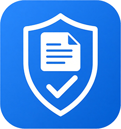

# eNoVa-Tor

**eNoVa_tor [v0.1 // 2026]**

Eingangstor für elektronische Notarvollzugsanfragen (XJustiz). Native Windows-Anwendung zur Annahme, Prüfung und Ablage von Ersuchen um Sachentscheidungen.

Native Windows-Anwendung zur Annahme, Prüfung, Bearbeitung und Ablage von Ersuchen um Sachentscheidungen im Format [XJustiz.enova. 2900003](https://xjustiz.justiz.de/Anwendungsfaelle/eNoVA/index.php) (Schema 3.6.2) per Drag-n-Drop aus [beBPo](https://de.wikipedia.org/wiki/Besonderes_elektronisches_Beh%C3%B6rdenpostfach) und anderen Transferkanälen.

> **Status: Work in Progress**
> - Automatisierte Ablage / DMS-Anbindung (DocuWare) ist in ersten Zügen implementiert, aber noch nicht produktiv getestet.
> - Keine Signaturimplementierung für Terminalkarten oder externe Vertrauensdienste (QTSP / BNotK).
> - Aktuell nur Mock-Signaturen für Entwicklung und Test.

**Autor:** Lenny Kunz

---

## Überblick

| Komponente | Technologie                                  |
| ---------- | -------------------------------------------- |
| Client     | WPF (.NET 10, Windows)                       |
| Server     | ASP.NET Core (.NET 10)                       |
| Datenbank  | PostgreSQL (Docker)                          |
| Signatur   | XML-DSig (enveloped), CAdES (detached), Mock |
| Ablage     | PDF/A-3 mit eingebettetem XML                |

---

## Funktionen

- Laden und Prüfen von XJustiz-Ersuchen (eingebettete oder detached Signatur)
- Ablehnung ungültiger oder fehlender Signaturen
- Native Vorschau ohne WebView
- Entscheidung erfassen, Antwort-XML und PDF/A-3 erzeugen
- Automatischer Upload auf den Server (optional DMS)
- Rollen: Organisationsverwalter, Behörden-Admin, Sachbearbeiter
- Einstellungen pro Behörde (Ausgabeordner, DMS, Absender)
- Audit-Log unter `%LocalAppData%\eNoVa_tor\logs`
- Sitzungs-Timeout nach 20 Minuten Inaktivität

---

## Voraussetzungen

- Windows 10/11
- [.NET 10 SDK](https://dotnet.microsoft.com/download)
- [Docker Desktop](https://www.docker.com/products/docker-desktop/)

---

## Installation

Intuitiv und unumständlich per Installationsskript mit Step-by-Step Guide

```bat
.\setup.bat
```

## Kompilierung der ausführbaren Programme

```bat
# Kompilierung des Client
.\publish-client.bat

# Kompilierung des Servers
.\publish-server.bat
```

Die ausführbaren Dateien heißen `eNoVa_tor.Client.exe` und `eNoVa_tor.Server.exe`.

---

## Start

```bat
docker compose -f docker/docker-compose.yml up -d
dotnet run --project src\Enova.Server\Enova.Server.csproj
dotnet run --project src\Enova.Client\Enova.Client.csproj
```

### Standardkonten

| Benutzer     | Passwort        | Rolle                  |
| ------------ | --------------- | ---------------------- |
| `admin`      | `ChangeMe!2026` | Organisationsverwalter |
| `egov-admin` | `ChangeMe!2026` | Behörden-Admin (EGOV)  |
| `editor1`    | `ChangeMe!2026` | Sachbearbeiter         |

Seeding weiterer Konten abschaltbar über `enova.seed.all=false` in `eNoVa_tor.server.properties`.

---

## Konfiguration

| Datei                                  | Zweck                                        |
| -------------------------------------- | -------------------------------------------- |
| `config/eNoVa_tor.server.properties`   | Server: Authority, Absender, Upload, Seeding |
| `config/eNoVa_tor.client.properties`   | Client: Server-URL, Ausgabeordner            |
| `config/eNoVa_tor.docuware.properties` | DocuWare-Fallback (optional)                 |

Im Build werden die jeweiligen Konfigurationsdateien in den jeweiligen Programmpfaden angelegt.

---

## Bekannte Einschränkungen

- **DMS:** DocuWare-Client ist eingebunden, Upload-Pfad aber nicht gegen ein reales System geprüft.
- **QES:** Keine Anbindung an Kartenleser, PKCS#11 oder EU-Trust-List. Mock-Zertifikate werden nur mathematisch geprüft.
- **Linux:** Server läuft plattformunabhängig. Client ist WPF und damit Windows-only.

---

## Struktur

```
src/
  Enova.Client/     WPF-Client
  Enova.Server/     ASP.NET Core API
  Enova.Core/       Konfiguration, Modelle
  Enova.Crypto/     Signatur-Provider
config/             Properties-Dateien
docker/             PostgreSQL Compose
samples/            Beispiel-Nachrichten
```

---

## Lizenz

CC BY-NC-SA 4.0 – Namensnennung-Nicht kommerziell-Share Alike 4.0 International
